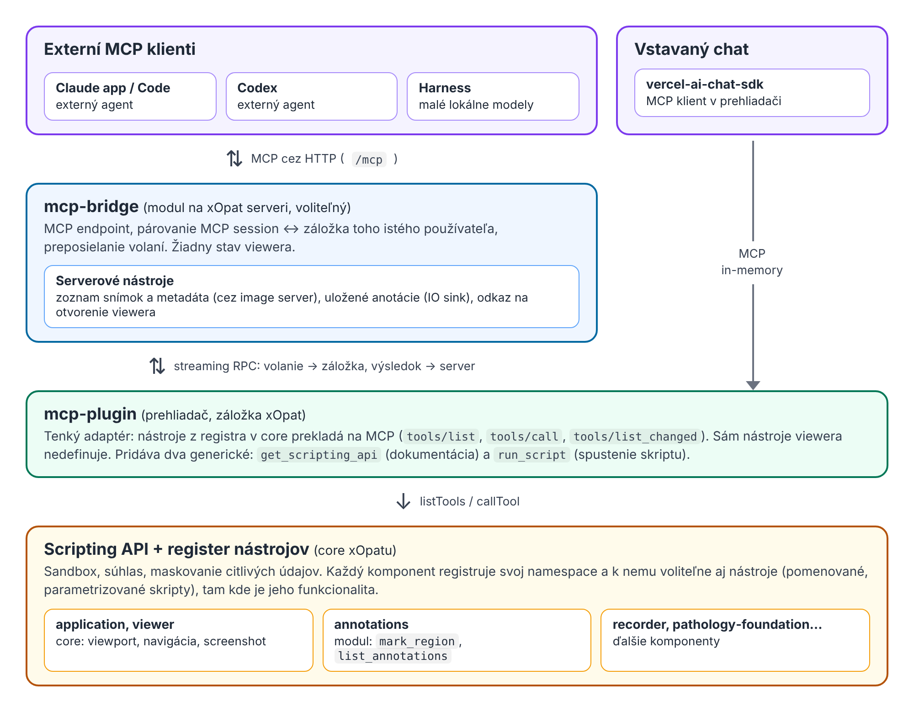

# Návrh architektúry MCP pre xOpat (detailný)

Stav k 20. 11. 2026, návrh na diskusiu. Krátka verzia: [mcp-nacrt.md](mcp-nacrt.md).



## 1. Hlavná myšlienka

MCP nie je náhrada Scripting API, ale **ďalší spôsob, ako ho sprístupniť**. Scripting ostáva
jadrom: všetky akcie vo vieweri idú cez neho (sandbox, súhlas, maskovanie). MCP pridáva:

- štandardné rozhranie pre **externých klientov** (Claude app, Codex, vlastný harness),
- **pevné nástroje so schémou** pre bežné úlohy, ktoré sú spoľahlivejšie pre malé modely,
- a vždy aj **priamy prístup ku scriptingu** cez dva generické nástroje:
  `get_scripting_api` (dokumentácia z manifestu) a `run_script` (spustenie skriptu).

Model si teda vyberie: jednoduchú akciu urobí pevným nástrojom, zložitú s cyklami a
reťazením napíše ako skript.

## 2. Vrstvy

| Vrstva | Kde | Úloha |
|---|---|---|
| **Scripting API + register nástrojov** | core xOpatu | Namespaces od komponentov a k nim voliteľne nástroje. Jediné miesto, kde sa definuje, čo sa dá s viewerom robiť. |
| **mcp-plugin** | prehliadač | Tenký adaptér: nástroje z registra prekladá na MCP. Pridá `get_scripting_api` a `run_script`. |
| **Vstavaný chat** | prehliadač | MCP klient cez in-memory transport. Dnešný jediný nástroj `run_viewer_script` sa stane jedným z mnohých. |
| **mcp-bridge** | xOpat server, voliteľný modul | Endpoint `/mcp`, párovanie MCP session so záložkou, preposielanie volaní, serverové nástroje. |
| **Externí klienti** | mimo xOpatu | Pripoja sa na `/mcp`. |

## 3. Ako komponenty pridávajú vlastné nástroje

Dnes komponent pridá namespace do scriptingu cez
`ScriptingManager.registerExternalApi(manager => manager.ingestApi(new MyApi(...)))`.
Takto to robia napríklad `modules/annotations`, `modules/recorder` a
`modules/pathology-foundation`. Scripting je core feature, takže komponent nezávisí od chatu.

**Návrh:** rovnakým mechanizmom, priamo pri namespace, môže komponent deklarovať aj
**nástroje**. Nástroj je pomenovaný, parametrizovaný skript nad jeho vlastným API:

```js
// modules/annotations/scripting/write.scripts.js (náčrt)
static tools = [{
    name: "annotations_mark_region",
    description: "Označí obdĺžnik vo vieweri ako anotáciu s danou triedou.",
    inputSchema: { type: "object", required: ["x", "y", "width", "height", "label"], properties: { ... } },
    // beží v rovnakom sandboxe ako akýkoľvek skript, args sú vstup od modelu
    script: `
        const preset = await annotations.ensurePreset(args.label);
        return await annotations.createAnnotation({ type: "rect", ...args, presetID: preset.id });
    `,
}];
```

Vlastnosti tohto riešenia:

- **Žiadna nová závislosť.** Register je súčasť core scriptingu. Anotácie nevedia nič
  o MCP ani o chate. Ak MCP nie je zapnuté, deklarácia sa jednoducho nepoužije.
- **Skratky sú tam, kde je funkcionalita.** „Vybrané skripty“ pre anotácie definujú anotácie.
- **Jedna cesta vykonania.** Nástroj je len skript s argumentmi, takže beží cez
  `executeScript` s rovnakým súhlasom a sandboxom ako `run_script`. Nevzniká nová,
  menej kontrolovaná cesta.
- **Core ponúkne dve funkcie:** `listTools(context)` (filtrované podľa súhlasu a zapnutých
  komponentov) a `callTool(name, args, context)`. Keď sa namespace pridá alebo odoberie,
  register vyšle udalosť a mcp-plugin pošle klientom `tools/list_changed`.
- **Konzumenti sú rovnocenní.** Vstavaný chat aj mcp-plugin čítajú ten istý register.

**Serverové nástroje komponentov** (napr. anotácie by vystavili niečo na serveri) majú zmysel
len tam, kde komponent naozaj má serverovú logiku. Anotácie ju dnes nemajú, takže ich
nástroje patria do prehliadača. Ak ju niektorý komponent má, analógia je konvencia
v jeho `*.server.ts` (napr. export `mcpTools`), ktorú server objaví rovnako ako dnes
RPC metódy. To je až druhý krok.

## 4. Čo vie server a aké nástroje môže dať

Server xOpatu **nedrží stav viewera** (otvorené snímky, viewport, anotácie na plátne),
ten je len v záložke. Úplne bezstavový však nie je, drží:

- HTTP sessions a prihlásenie (identita, CSRF, OIDC/SAML tokeny),
- históriu vstavaného chatu a API kľúče používateľov (`vercel-ai-chat-sdk`),
- dáta pluginov, ak admin nastaví IO sink na server (`http-rest`),
- konfiguráciu nasadenia (ENV, proxy na image server).

Snímky samotné nedrží: zoznam a metadáta poskytuje **image server** (napr. wsi-service),
ku ktorému xOpat pristupuje cez proxy.

Serverové nástroje v `mcp-bridge` (fungujú aj bez otvorenej záložky):

- `list_slides`, `get_slide_metadata`, `get_slide_thumbnail` (cez image server),
- `list_saved_annotations` (ak je nastavený serverový IO sink),
- `open_viewer` (vráti odkaz na viewer so zvolenou snímkou alebo session).

Relay potrebuje jediný vlastný stav: **ktorá MCP session patrí ku ktorej záložke**. Je
krátkodobý, viazaný na prihláseného používateľa, a v nasadení s viacerými workermi musí
ísť do zdieľaného úložiska servera, nie do pamäte jedného procesu.

## 5. Scripting vs. MCP a tokeny

- **Pravda:** skript vie reťaziť a urobí viac za jedno kolo modelu. Preto je `run_script`
  (spolu s `get_scripting_api`) **jeden z vystavených MCP nástrojov**. Problém s reťazením
  tým odpadá: MCP nič neberie, len k scriptingu pridáva pevné nástroje a externých klientov.
- **Ale:** text skriptu aj jeho výsledok sú tiež súčasťou konverzácie, rovnako ako volanie
  nástroja. Úspora tokenov vznikne, až keď medzivýsledky ostanú mimo kontextu. Scripting
  na to už má `context.storeResult()` a `application.readScriptResult()` (veľký výsledok
  sa uloží pod handle a model si číta len výrez). To isté použijeme pri MCP nástrojoch.
- **Malé modely** píšu kód výrazne horšie, než volajú nástroj so schémou. Pevné nástroje
  sú pre ne spoľahlivejšie a dajú sa im vracať zrozumiteľné chyby.
- **Pre bakalárku** je to priamo meraná otázka: pevné nástroje vs. `run_script` vs. oboje,
  na malých modeloch aj na Claude a Codexe.

## 6. Bezpečnosť

- Všetko ide cez Scripting API, takže platí súhlas a maskovanie citlivých údajov.
- `/mcp` vyžaduje prihlásenie a MCP session sa spáruje len so záložkou toho istého používateľa.
- `run_script` a zapnutie `mcp-bridge` sa riadia konfiguráciou nasadenia (ENV), nie URL.
- Text zo snímok a anotácií je pre model nedôveryhodný vstup a vo výsledkoch sa tak označí.

## 7. Poradie implementácie

1. Register nástrojov v core scriptingu (`listTools`, `callTool`, udalosť pri zmene) a prvé
   nástroje pre `viewer` a `annotations`.
2. `mcp-plugin` + `get_scripting_api` + `run_script`, test cez in-memory klienta.
3. Vstavaný chat ako MCP klient nad registrom.
4. `mcp-bridge`: `/mcp`, párovanie so záložkou, serverové nástroje.
5. Experimenty (variant C cez Playwright pre reprodukovateľné behy).

## Otvorené otázky

- Je vhodné rozšíriť priamo core scripting o register nástrojov, alebo to má byť samostatná
  core trieda vedľa neho?
- Má byť nástroj vždy skript (jedna cesta, sandbox), alebo povoliť aj host-side funkciu
  pre výkon?
- Ktoré serverové nástroje sú pre vás najužitočnejšie?
