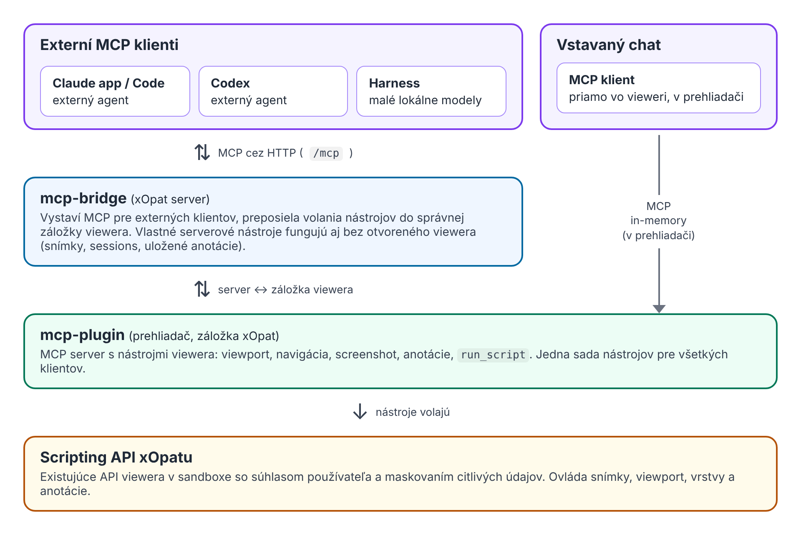

# Návrh architektúry MCP pre xOpat

## mcp-plugin (prehliadač)

Plugin xOpatu, ktorý v záložke viewera spúšťa MCP server. Definuje nástroje viewera
(viewport, navigácia, screenshot, anotácie a `run_script` na spustenie skriptu) a vykonáva ich
cez Scripting API, takže platia rovnaké pravidlá ako pri vstavanom chate (sandbox, súhlas
používateľa, maskovanie citlivých údajov). Je to jediné miesto, kde sú nástroje viewera
definované. Samotné Scripting API je existujúca najnižšia vrstva xOpatu, plugin ho len volá.

## mcp-bridge (server)

Tenký relay na xOpat serveri. Klientom vystaví MCP endpoint a volania nástrojov viewera
prepošle do správnej záložky, odkiaľ vráti výsledok. Sám skripty neskladá ani viewer
neovláda. Navyše ponúka serverové nástroje, ktoré fungujú aj bez otvoreného viewera
(zoznam snímok, sessions, uložené anotácie, otvorenie session). Keď sa pripojí záložka,
klient uvidí aj nástroje viewera.

## MCP klienti

Externí klienti (Claude app, Claude Code, Codex alebo vlastný harness s malými lokálnymi
modelmi) sa pripoja cez `mcp-bridge`. Vstavaný chat vo vieweri je rovnocenný klient, ktorý
sa na `mcp-plugin` pripojí priamo v prehliadači. Všetci dostanú rovnakú sadu nástrojov,
takže sa dajú porovnávať na rovnakých úlohách.
