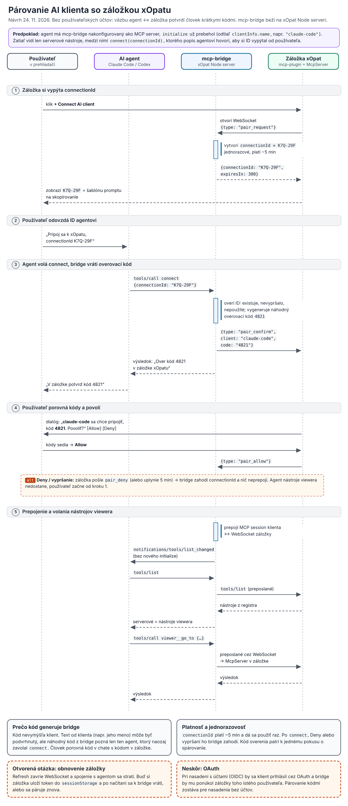

# Párovanie AI klienta so záložkou xOpatu

Návrh dohodnutý 24. 11. 2026. Nasadenie bez používateľských účtov, takže väzbu „tento agent ↔ táto záložka“
potvrdí človek. `mcp-bridge` beží na xOpat Node serveri, nie na slide serveri (wsi-service).

**Predpoklad:** agent (Claude Code, Codex) má `mcp-bridge` nakonfigurovaný ako MCP server a `initialize` už prebehol
(odtiaľ `clientInfo.name`). Zatiaľ vidí len serverové nástroje, medzi nimi `connect(connectionId)`. Popis nástroja
agentovi hovorí, že ID si má vypýtať od používateľa.

## Priebeh

1. **Záložka si vypýta ID.** Používateľ klikne na „+ Connect AI client“. Záložka otvorí WebSocket na `mcp-bridge`,
   bridge pridelí krátke jednorazové `connectionId` (napr. `K7Q-29F`, platí asi 5 minút) a záložka ho zobrazí
   spolu so šablónou promptu na skopírovanie.
2. **Používateľ ho odovzdá agentovi** vložením do chatu.
3. **Agent zavolá `connect(connectionId)`.** Bridge overí, že ID existuje, nevypršalo a nebolo použité, vygeneruje
   náhodný overovací kód (napr. `4821`), pošle ho záložke a vráti ho aj agentovi, ktorý ho povie používateľovi.
4. **Potvrdenie v záložke.** Záložka ukáže „claude-code sa chce pripojiť, kód 4821. Povoliť?“. Používateľ porovná
   kódy a klikne Allow. Pri Deny alebo vypršaní bridge ID zahodí a nič neprepojí.
5. **Prepojenie.** Bridge spojí MCP session klienta s WebSocketom záložky a pošle `notifications/tools/list_changed`
   (bez nového `initialize`). Agent zavolá `tools/list` a vidí aj nástroje viewera. Ďalšie `tools/call` bridge
   preposiela cez WebSocket do `McpServer` v záložke a výsledok vracia agentovi.

## Poznámky

- **Prečo kód generuje bridge:** text, ktorý pošle klient (napríklad jeho meno), môže byť podvrhnutý. Náhodný kód
  z bridge pozná len agent, ktorý naozaj zavolal `connect`.
- **Platnosť:** `connectionId` platí asi 5 minút a dá sa použiť raz.
- **Otvorená otázka:** refresh záložky zavrie WebSocket a spojenie sa stratí. Buď si záložka uloží token do
  `sessionStorage` a po načítaní sa vráti, alebo sa páruje znova.
- **Neskôr:** OAuth pre nasadenia s účtami (OIDC). Párovanie kódmi zostáva pre nasadenia bez účtov.
