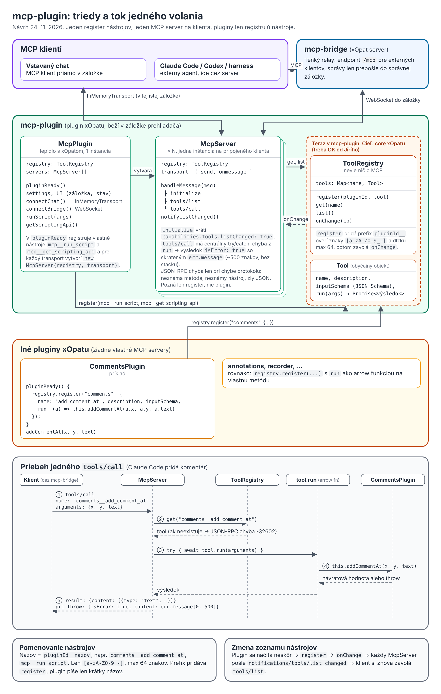

# mcp-plugin: triedy a tok jedného volania

Návrh dohodnutý 24. 11. 2026. Plugin píše Marek, obrázok je len mapa.

## Tri triedy

**ToolRegistry** drží nástroje v `Map<name, Tool>`, kde `Tool = { name, description, inputSchema, run(args) }`.
Metódy: `register(pluginId, tool)`, `get(name)`, `list()`, `onChange(cb)`. O MCP nevie nič, je to len zoznam
pomenovaných funkcií. Zatiaľ žije v `mcp-plugin`, neskôr by mal ísť do core xOpatu (treba súhlas Jiřího).

**McpServer** je jedna inštancia na každého pripojeného klienta (vstavaný chat cez in-memory transport,
Claude Code / Codex cez `mcp-bridge` a WebSocket). Spracúva `initialize` (s `capabilities.tools.listChanged`),
`tools/list` a `tools/call`. Má odkaz len na register, nie na plugin. Prihlási sa na `registry.onChange`
a pri zmene pošle klientovi `notifications/tools/list_changed`.

**McpPlugin** je lepidlo s xOpatom: `pluginReady`, nastavenia, UI. Vytvára transporty a k nim
`new McpServer(registry, transport)`. Sám registruje dva nástroje: `mcp__run_script` a `mcp__get_scripting_api`.

## Ostatné pluginy

Iný plugin (napríklad komentáre) nemá vlastný MCP server. Len zavolá
`registry.register("comments", { name: "add_comment_at", ..., run: (a) => this.addCommentAt(a.x, a.y, a.text) })`.
Arrow funkcia drží `this`, takže nástroj volá priamo metódu pluginu.

## Pravidlá

- **Názvy:** `pluginId__nazov` (napr. `comments__add_comment_at`), len `[a-zA-Z0-9_-]`, max 64 znakov. Prefix pridáva `register`.
- **Chyby:** v `tools/call` je jeden centrálny try/catch. Výnimka z `run` sa vráti ako bežný výsledok
  `isError: true` so skráteným `err.message` (asi 500 znakov, bez stacku), aby ju model videl a mohol sa opraviť.
  JSON-RPC chyba je len pri chybe protokolu: neznáma metóda, neznámy nástroj, zlý JSON.

## Tok jedného volania

1. Klient pošle `tools/call` s názvom `comments__add_comment_at` a argumentmi.
2. McpServer si nástroj vypýta cez `registry.get(name)`. Ak neexistuje, vráti JSON-RPC chybu.
3. V try/catch zavolá `await tool.run(arguments)`.
4. Arrow funkcia zavolá `this.addCommentAt(x, y, text)` v CommentsPlugin.
5. McpServer zabalí výsledok do `{ content: [...] }`, alebo pri výnimke do `{ isError: true, ... }`, a pošle ho klientovi.
